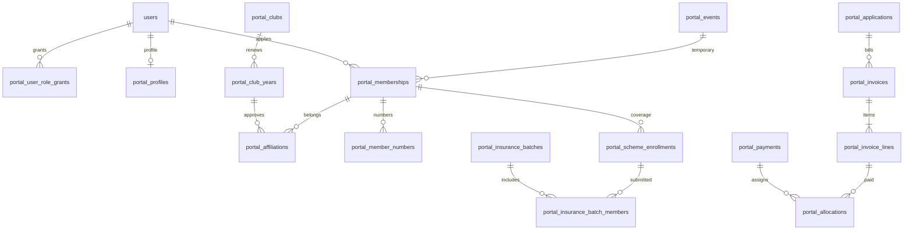

# DB設計

> 2026-10-28: [追加回答の反映と対応方針](../20261028_追加回答の反映と対応方針.md)を追記。Temporaryは同日1イベントへ制限する必要があります。現行のevent_id単位の一意制約だけでは不足しており、日本時間の参加日を用いた制約の追加は未実装です。

2026-10-27 / 論理・物理設計案。[追加DDL](../../design/phase2/001_portal_schema.sql)を作成し、本番同一MariaDB 10.5.29で隔離検証済み。[検証結果と具体化した制約](20261027_本番確認・DDL検証結果.md)を優先する。本番未適用。

## 1. 共通ルール

同一MariaDB/InnoDB、utf8mb4を第一候補。既存IDはBIGINT UNSIGNED。新テーブルIDも同型、参照元usersを変更しない。VARCHARの照合順序/インデックス長/CHECKの実効性は実機バージョン確認後に確定する。

以下の列記法: PK=主キー、FK=外部キー、UQ=一意、?=NULL許可。指定なしはNOT NULL。共通列 `created_at DATETIME(6)`、更新可能テーブルに `updated_at DATETIME(6), row_version BIGINT UNSIGNED DEFAULT 1`。時刻はUTC保存/Asia/Tokyo表示を新領域に採用し、既存JST日時との変換はアダプターで明示する。年度・イベント日はJSTの日付から決める。入金額は円単位BIGINT（少数なし）。

外部キーは原則RESTRICT。ユーザー削除による会員/請求/監査のCASCADEを使わない。既存usersの削除方針を先に解決する。複合外部キーで年度・クラブ整合性を保証し、状態や有効期間などDBだけで表せない条件はロックを含むサービスで検証する。

番号はCHAR/VARCHAR、先頭ゼロを保存する。表示会員番号・メール・クラブコードを内部FKにしない。免許証/ライセンスは種類別に正規化し、原値を暗号化、検索は種類別の鍵付きHMAC（鍵版付き）を用いる。暗号化鍵はDB/リポジトリ外。重複は候補として扱い自動アカウント統合しない。

## 2. 関連図

## 3. ID・認証・権限

| テーブル | 主な列・制約 |
| --- | --- |
| portal_account_controls | user_id BIGINT PK/FK users、status VARCHAR(16)（active/blocked）、auth_version BIGINT、blocked_at DATETIME?、blocked_by BIGINT? FK users。users.role_idは変更しない |
| portal_roles | id BIGINT PK、code VARCHAR(40) UQ、name VARCHAR(80)。OFFICE/FINANCE/CLUB_REP/SYSTEM_OPERATOR等 |
| portal_role_permissions | role_id FK、permission_code VARCHAR(80)、PK(role_id,permission_code)。業務能力の許可リスト |
| portal_user_role_grants | id PK、user_id/role_id FK、scope_type VARCHAR(12)（global/club）、scope_id BIGINT（globalは0、clubはclub_id）、status VARCHAR(16)、valid_from/valid_until? DATETIME、granted_by/approved_by?/revoked_by? FK users、revoked_at?。UQ(user_id,role_id,scope_type,scope_id)、INDEX(user_id,status)。履歴は監査に保持。clubの実在はサービス検証（0のため単純FK不可） |
| portal_profiles | user_id PK/FK users、last_name/first_name/last_kana/first_kana VARCHAR(64)?、birthday DATE?、gender VARCHAR(16)?、postcode VARCHAR(16)?、address VARCHAR(255)?、phone/mobile VARCHAR(32)?。下書きはNULL可、申請時に必須検証。email/passwordは持たない |
| portal_identifiers | id PK、user_id FK、kind VARCHAR(24)、value_cipher MEDIUMBLOB、lookup_hmac BINARY(32)、key_version SMALLINT、license_type VARCHAR(40)?、expires_on DATE?、verified_at DATETIME?。UQ(user_id,kind,lookup_hmac)、INDEX(kind,lookup_hmac)。同一番号の別ユーザーは申請保留で解決 |

競技/審判員ライセンスは種類別レコードを許可。Generalの採番元選択はR01/R02待ち。プロフィール訂正と識別番号変更は別処理、氏名/生年月日の訂正は勝手に許可しない。

## 4. 年度・クラブ・イベント

| テーブル | 主な列・制約 |
| --- | --- |
| portal_years | year SMALLINT UNSIGNED PK、valid_from/valid_until DATETIME、club_open_at/club_close_at DATETIME、member_self_open_at DATETIME?、staff_open_at DATETIME、source_mode VARCHAR(16)（legacy/shadow/portal）、policy_version VARCHAR(32)。終了時刻は翌年1/1の排他的境界。2027クラブ締切2/7の時刻は運営確認後設定 |
| portal_club_categories | category_digit CHAR(1) PK、name VARCHAR(64)、enabled BOOLEAN。数字対応は未投入 |
| portal_clubs | id PK、fixed_code CHAR(5) UQ、name_full VARCHAR(255)、name_short VARCHAR(128)、legacy_affiliated_id BIGINT? UQ/FK jmrc_affiliated_clubs、status VARCHAR(16)。未照合クラブは本番登録せず移行保留表で管理 |
| portal_club_years | id PK、club_id FK、year FK、category_digit FK、display_code CHAR(6)、application_id BIGINT UQ/FK、status VARCHAR(16)、rep_name/contact_name VARCHAR(128)、postcode VARCHAR(16)、address VARCHAR(255)、phone VARCHAR(32)、email VARCHAR(190)、bank_details_cipher MEDIUMBLOB?、approved_by? FK users、approved_at?。UQ(club_id,year)、UQ(year,display_code)、UQ(id,year)、INDEX(year,status)。display_code=区分+固定番号をサービスで検証 |
| portal_organizer_links | legacy_club_user_id FK clubs(user_id)、portal_club_id FK、verified_by FK users、verified_at DATETIME、PK(legacy_club_user_id,portal_club_id)。コード一致だけで代表権限を付けない |
| portal_events | id PK、legacy_event_id BIGINT? UQ/FK jmrc_events、organizer_club_year_id FK、year SMALLINT、title VARCHAR(255)、starts_at/ends_at DATETIME、status VARCHAR(16)。クラブ年度との複合FK、イベント年度一致、期間整合を検証。entry外イベントも保持可 |

クラブ連絡先/口座は年度申請スナップショット。公開一覧は許可した項目のみ投影する。複数主催クラブのTemporary採番元、日付変更時の資格再計算はR04と運営確認に従う。

## 5. 申請・個人会員・所属・番号

| テーブル | 主な列・制約 |
| --- | --- |
| portal_applications | id PK、kind VARCHAR(32)、applicant_user_id FK、year FK、status VARCHAR(20)、request_key VARCHAR(64) UQ、submitted_at?、decided_at?、decided_by? FK、reason TEXT?。申請対象は各業務テーブルからFKで参照。下書き以外の正本を自由JSONだけに保存しない |
| portal_memberships | id PK、user_id FK、year FK、member_type VARCHAR(16)（general/temporary）、event_id BIGINT? FK、application_id FK UQ、status VARCHAR(20)、valid_from/valid_until DATETIME?、activated_at?、suspended_at?。UQ(id,year)。generalはevent_id NULL、temporaryは必須。general_user_key=general時user_id/他NULLの生成列UQ(year,general_user_key)、temporary_user_key=temporary時user_id/他NULLの生成列UQ(event_id,temporary_user_key)。生成列DDLは実機確認後 |
| portal_affiliations | id PK、membership_id BIGINT、year SMALLINT、club_year_id BIGINT、status VARCHAR(20)、requested_at DATETIME、decided_at?、decided_by? FK users、valid_from/valid_until?、match_source_id BIGINT? FK事前登録、reason TEXT?。複合FK(membership_id,year)/(club_year_id,year)。current_membership_key=承認済みかつvalid_until NULL時membership_id/他NULL、UQ(current_membership_key)。年度途中変更は旧行終期と新行始期を同時更新 |
| portal_preregistrations | id PK、club_year_id FK、identifier_kind VARCHAR(24)、identifier_hmac BINARY(32)、key_version SMALLINT、status VARCHAR(16)、created_by FK、matched_user_id? FK、matched_at?。UQ(club_year_id,identifier_kind,key_version,identifier_hmac)。氏名やメールだけで自動承認しない |
| portal_member_numbers | id PK、membership_id FK、source_kind VARCHAR(24)、source_identifier_id FK、club_year_id FK、number_cipher MEDIUMBLOB、number_hmac BINARY(32)、key_version SMALLINT、valid_from/valid_until?。current_member_key=終期NULL時membership_id/他NULL UQ、UQ(membership_id,number_hmac)。表示番号の重複は年度/種別/イベントの業務検証で検出し、イベント横断では一律UQにしない |
| portal_card_tokens | id PK、membership_id FK、token_hash BINARY(32) UQ、expires_at DATETIME、revoked_at?、issued_by FK。平文トークンは保存しない。公開照会で年度・資格・承認済み公開項目のみ返す |

会員番号の元になる識別番号が変わっても内部membership_idは不変。名簿・入金の紐付けに表示番号を使わない。General/Temporary併存や切替時の課金はR04待ち、既存資格を暗黙取消しない。

### 状態と成立条件

申請: draft→submitted→approved/rejected/returned。returned→submittedを許可。draft取消しは可能。却下/差戻しは理由必須の設計案。会員: pending→active→suspended（解除はactive）。年度終了は時刻判定、退会操作を追加しない。

activeの条件は「メール認証済み・アカウント有効・申請承認・年度クラブ承認・有効所属・必要請求充当済み・期間内・区分要件適合」。各条件を別列/関連で評価する。paidという自己申告だけでは成立させない。General会員証は成立時のみ。Temporaryはイベント日内資格、メニュー閲覧は年度内で別判定。

旧年度から移行する資格は、事務局が確認した根拠を `portal_qualification_evidence` に保存する。列はid PK、membership_id FK、purpose_code VARCHAR(32)、basis VARCHAR(24)（legacy_payment/waiver等）、source_table VARCHAR(64)、source_id VARCHAR(128)、source_hash BINARY(32)、confirmed_by FK users、confirmed_at DATETIME、revoked_at DATETIME?、reason TEXT。UQ(membership_id,purpose_code,source_table,source_id)。免除の可否は別途承認が必要で、初期有効化しない。通常の請求充当に代わる移行証拠は明示的に確認された場合だけ許可し、支払額と同じ意味にはしない。

membership.statusは管理状態/投影であり、active値だけで権利を許可しない。参照時に停止・期間・所属・充当または有効な移行証拠を再評価し、遅延ジョブの有無で資格がずれないようにする。

## 6. 費用・口座・入金

| テーブル | 主な列・制約 |
| --- | --- |
| portal_fee_rules | id PK、year FK、purpose_code VARCHAR(32)、member_type VARCHAR(16)、amount_yen BIGINT、charge_unit VARCHAR(16)（year/event等）、valid_from/valid_until DATETIME、enabled BOOLEAN。同じ条件の有効期間重複をロックして拒否。General2000/Temporary500は設定値、クラブ/保険は未確定 |
| portal_bank_accounts | id PK、purpose_code VARCHAR(32)、year SMALLINT?、display_name VARCHAR(128)、details_cipher MEDIUMBLOB、payment_url VARCHAR(2048)?、valid_from/valid_until?、enabled BOOLEAN、updated_by FK。変更しても発行済み請求案内は変更しない |
| portal_invoices | id PK、application_id FK、invoice_no VARCHAR(40) UQ、payer_user_id? FK、payer_club_year_id? FK、status VARCHAR(16)、due_at?、account_id FK、account_snapshot_cipher MEDIUMBLOB、payment_url_snapshot VARCHAR(2048)?、idempotency_key VARCHAR(80) UQ、issued_at?、finalized_at?。払主はいずれか1つ |
| portal_invoice_lines | id PK、invoice_id FK、fee_rule_id? FK、purpose_code VARCHAR(32)、membership_id? FK、scheme_enrollment_id? FK、club_year_id? FK、description VARCHAR(255)、quantity INT、unit_amount_yen BIGINT、amount_yen BIGINT。正の通常請求と取消/調整を明示区別し、発行後の直上書きを禁止 |
| portal_bank_imports | id PK、account_id FK、file_sha256 BINARY(32)、parser_version VARCHAR(32)、status VARCHAR(16)、imported_by FK、imported_at DATETIME。UQ(account_id,file_sha256)。未確定行はプレビューまで |
| portal_payments | id PK、account_id FK、import_id? FK、source_type VARCHAR(16)、source_key VARCHAR(128)、received_at DATETIME、amount_yen BIGINT、payer_name_cipher MEDIUMBLOB、status VARCHAR(16)、confirmed_by? FK、confirmed_at?。UQ(account_id,source_type,source_key)。CSVの銀行取引IDがなければ暫定fingerprintと同額同名義重複候補を人が確認 |
| portal_allocations | id PK、payment_id FK、invoice_line_id FK、amount_yen BIGINT、operation_key VARCHAR(80) UQ、reverses_id? FK自表、created_by FK、reason TEXT?。入金充当は正、取消は元行を指す負の逆仕訳。reverses_id UQで同じ行の二重取消を防止 |
| portal_refunds | id PK、payment_id FK、amount_yen BIGINT、status VARCHAR(16)、requested_by FK、confirmed_by? FK、paid_at?、external_reference VARCHAR(128)?、reason TEXT。返金も取消と区別して支払記録を残す |

金額・単位・口座案内は請求時点で固定。請求総額=明細合計、充当済額=有効充当合計、入金残=入金−有効充当−実行済返金。過入金は未充当残として保管し、自動で別人/別請求へ移さない。Payment Core URLへ遷移したことを入金扱いにしない。

### 同時処理

請求発行は申請をロックしidempotency_keyで重複防止。消込は入金と対象請求をID昇順にFOR UPDATEし、残額・明細残額・修正権限・row_versionを再検証→充当追加→資格再判定→監査と通知outboxを同一トランザクションで記録。デッドロックは回数を限定して再試行する。

確定後修正は事務局/財務のみ。元行を削除せず取消+再充当し、資格が未成立へ戻る場合は会員証を即時無効化。外部保険の加入成立は入金修正だけで勝手に取消しない。差額対応は事務局確認へ送る。複数明細を持つ一括入金は配分を明示し、資格を一括でpaidにしない。

## 7. 保険・見舞金・部会基金

| テーブル | 主な列・制約 |
| --- | --- |
| portal_schemes | code VARCHAR(32) PK、name VARCHAR(128)、owner_scope VARCHAR(32)、enabled BOOLEAN。sports_safety/association_relief/gymkhana_fundを別コード |
| portal_scheme_enrollments | id PK、membership_id FK、scheme_code FK、year FK、application_id FK、status VARCHAR(20)、coverage_from/coverage_until DATETIME?、beneficiary_cipher MEDIUMBLOB?、external_reference VARCHAR(128)?、activated_by? FK。UQ(membership_id,scheme_code,year)。基金の正本をこちらへ移すかはR10待ち |
| portal_insurance_batches | id PK、club_year_id FK、scheme_code FK、kind VARCHAR(16)（initial/additional）、status VARCHAR(20)、template_version VARCHAR(40)、submitted_at?、accepted_at?、created_by FK |
| portal_insurance_batch_members | batch_id FK、enrollment_id FK、status VARCHAR(16)、PK(batch_id,enrollment_id)。申込済み加入の重複提出はサービスで拒否。初回4名や追加条件はR09確定後に適用 |
| portal_documents | id PK、kind VARCHAR(32)、batch_id? FK、storage_key VARCHAR(255) UQ、sha256 BINARY(32)、template_version VARCHAR(40)、generated_by FK、generated_at DATETIME、visibility VARCHAR(24)、expires_at?。帳票を公開ディレクトリへ保存しない |

保険状態: requested→batched→submitted→active/rejected。出力しただけでは加入成立しない。加入証表示は外部成立確認後。Temporaryの当日見舞金と年間スポーツ安全保険の期間を混同しない。

## 8. 監査・移行・通知

| テーブル | 主な列・制約 |
| --- | --- |
| portal_audit_events | id PK、actor_user_id? FK、action VARCHAR(80)、entity_type VARCHAR(40)、entity_id BIGINT、request_id VARCHAR(64)、reason TEXT?、changes_redacted TEXT、occurred_at DATETIME。INDEX(entity_type,entity_id,occurred_at)。免許番号等の平文をdetailsに入れない |
| portal_outbox | id PK、event_key VARCHAR(100) UQ、event_type VARCHAR(80)、entity_id BIGINT、payload_minimal TEXT、status VARCHAR(16)、attempts INT、next_attempt_at DATETIME?、sent_at?。メール失敗で業務確定を巻き戻さず再送 |
| portal_migration_links | id PK、source_table VARCHAR(64)、source_id VARCHAR(128)、target_table VARCHAR(64)、target_id BIGINT、source_hash BINARY(32)、batch_key VARCHAR(64)、status VARCHAR(20)、reviewed_by? FK。UQ(source_table,source_id,target_table)。出所を追跡 |
| portal_retention_policies | code VARCHAR(40) PK、duration_days INT?、enabled BOOLEAN、approved_by? FK、approved_at?。値未決なら削除処理を有効化しない。2年は日数固定か暦年かも明示 |

ログ2年・下書き3か月・未更新会員・会計・バックアップは別方針。本人削除でFKを切って無条件に連鎖削除しない。保持義務と運営判断の確定後、再識別可能な番号/スナップショット/帳票/通知/バックアップを含めた削除手順を設計する。

## 9. 物理設計の未完事項

DDLでは生成列によるUQのMariaDB互換性、複合FKの列型/索引、暗号鍵の保管、最大番号長、検索負荷、付与履歴の保持を検証する。既存SQLのjmrc_entry_fees.entry_idはINTでjmrc_entries.idはBIGINTのため、そのまま新FK設計を模倣しない。データと実機確認なしにALTER/VIEW置換SQLを配布しない。
